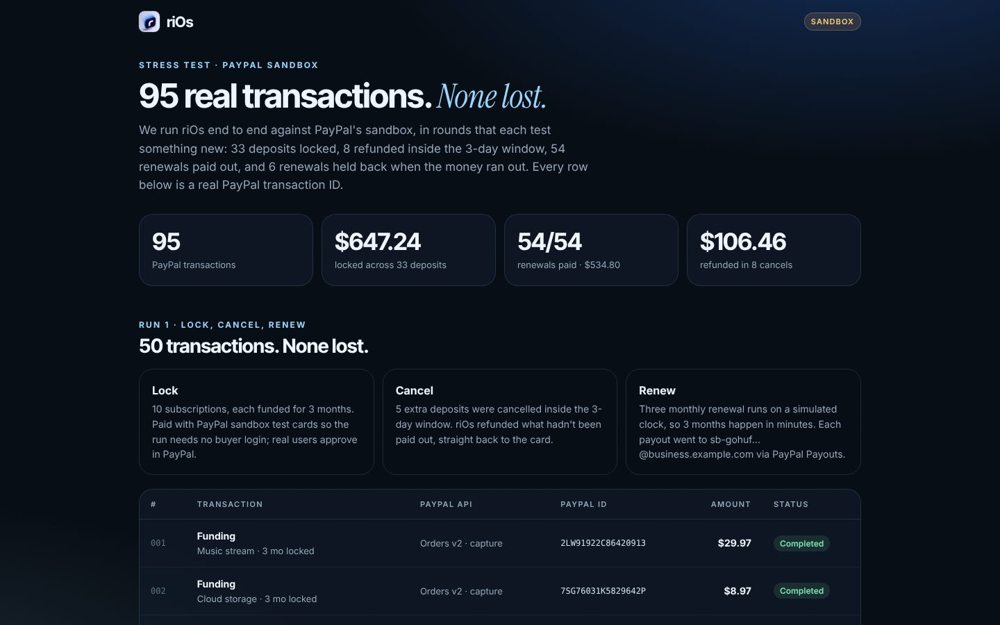
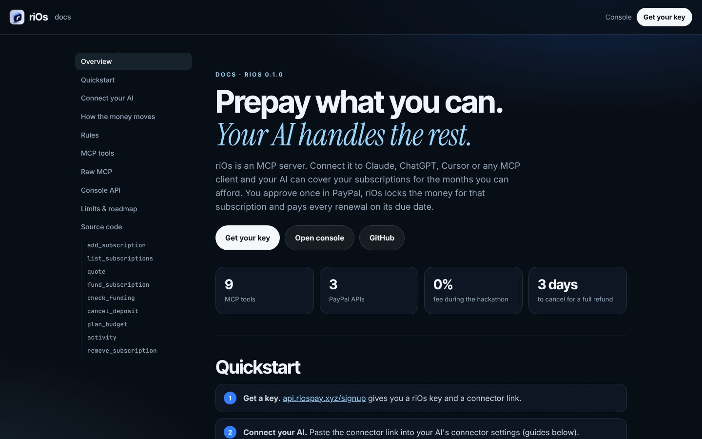
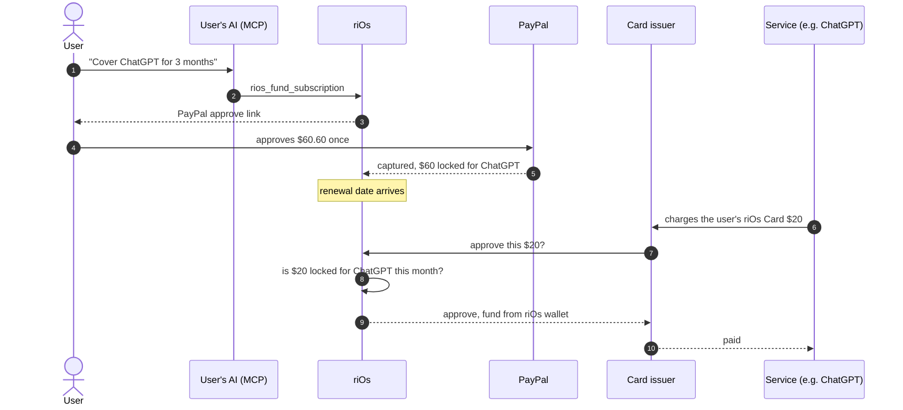
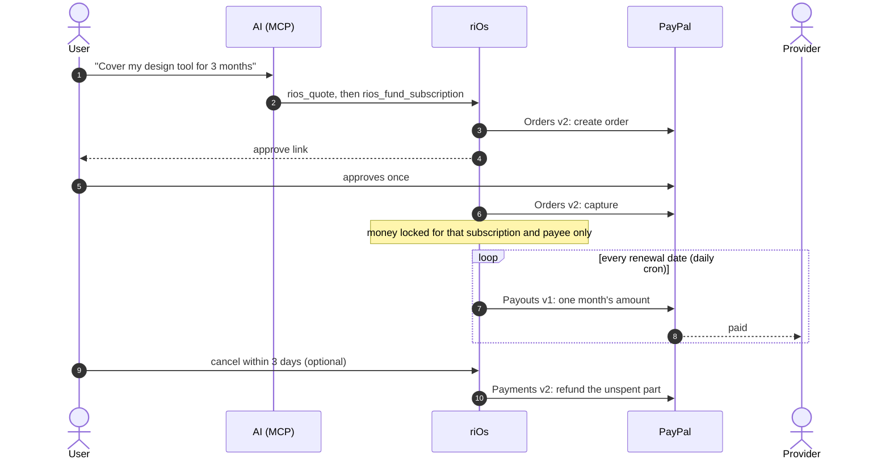

# riOs


[](https://api.riospay.xyz/proof)
[](https://riospay.xyz)


**Your subscriptions, covered ahead.**

Subscriptions bill on fixed dates. Income doesn't. riOs lets people lock in the months they can afford on the day they get paid, and pays every renewal on its due date, so a slow month never cuts off the tools they work with. It lives inside the AI they already use: one message to Claude, ChatGPT or Cursor, one approval in PayPal, months covered.

- **Website:** https://riospay.xyz
- **Console:** https://api.riospay.xyz/app · **Docs:** https://api.riospay.xyz/docs
- **Proof (every PayPal transaction ID):** https://api.riospay.xyz/proof
- **Pricing (machine-readable):** https://api.riospay.xyz/pricing.json
- **X:** [@riOspayHQ](https://x.com/riOspayHQ) · **YouTube:** [@riospayxyz](https://youtube.com/@riospayxyz)
- **Company:** RIOSPAY INTEGRATED SERVICES, registered with the Corporate Affairs Commission (CAC), Nigeria
- **Built for:** PayPal AI Hackathon, November 2026
- **Built by:** Favour ([@Favour_D_Crier](https://x.com/Favour_D_Crier))

| The website | Public proof of every transaction | Docs for developers and AIs |
| --- | --- | --- |
| <a href="https://riospay.xyz"></a> | <a href="https://api.riospay.xyz/proof"></a> | <a href="https://api.riospay.xyz/docs"></a> |

## Proof: 95 PayPal transactions, none lost

riOs is tested end to end against the PayPal sandbox through the same code paths real users hit, in rounds that each try a new real-life scenario. Every transaction ID is public at **[api.riospay.xyz/proof](https://api.riospay.xyz/proof)** ([JSON](https://api.riospay.xyz/proof.json)).

| Run | Scenario | What happened |
| --- | --- | --- |
| **1. Lock, cancel, renew** | 10 subscriptions funded for 3 months, 5 extra deposits cancelled, three monthly renewal runs | 15 deposits locked, 5 refunded inside the 3-day window, **30 of 30 renewals paid** |
| **2. Payday** | Three uneven paydays split by the budget planner across 5 subscriptions with different renewal days | 3 mistaken deposits refunded, **24 of 24 renewals paid** over six months, 6 renewals correctly held back once their money ran out |
| **Total** | | **33 deposits** (Orders v2), **8 refunds** (Payments v2), **54 of 54 renewals paid** (Payouts v1). 0 failed, 0 lost |

The runs live in [`src/stress.js`](src/stress.js) and only ever touch their own test accounts. The count keeps growing, one new scenario per round.

## The market

**Who riOs is for.** Freelancers, creators, contractors, students and anyone paid in seasons instead of salaries. Their tools (ChatGPT, Claude, Figma, Adobe, Canva, CapCut, Notion, Spotify) bill every month on a fixed date, whether or not a client paid that month.

**What they deal with today.**
- A good month can't protect a bad one. Money that arrives in March is spent by May, and the tools lapse right when work is scarce.
- Yearly plans need a lump sum most people never have at once. Monthly plans need money every single month.
- Across Africa and other emerging markets, local cards are often declined for dollar subscriptions, so even people with money lose access.

**What riOs gives them.** "I just got paid, cover me for three months." The money is locked for those subscriptions only, and each renewal is paid on its date. People budget once, on payday, and stop thinking about it.

**Why now.** People are starting to run their money through AI assistants. riOs is built as an MCP server, so it shows up wherever those assistants are: Claude, ChatGPT, Cursor and any MCP client. No new app to download, and the AI can add, quote, fund and track subscriptions in plain language.

## How riOs makes money

Live pricing is served at [`/pricing.json`](https://api.riospay.xyz/pricing.json) from [`src/pricing.js`](src/pricing.js), and the vault charges exactly that.

| | Price | When |
| --- | --- | --- |
| **First-month fee** | **3% of one month's price** | Once, the first time a subscription is funded |
| **Every month after that** | **Free** | Top up the same subscription as often as you like |
| **riOs Card** (next layer) | **$1.50, once** | When a user gets their card. No monthly card fee |
| **Interchange share** (next layer) | Paid by the card network, not the user | On every renewal the riOs Card pays |

riOs is **free during the beta**. Launch pricing is switched on with one setting (`RIOS_FIRST_MONTH_FEE_BPS=300`); the tests prove the fee is charged once per subscription and never again.

**Worked example: ChatGPT Plus at $20 a month.**

| Funding | Covers | riOs fee | User pays |
| --- | --- | --- | --- |
| First: 3 months | $60.00 | $0.60 (3% of $20) | $60.60 |
| Top-up: 3 more months | $60.00 | $0.00 | $60.00 |
| riOs Card (once, when cards launch) | | $1.50 | $1.50 |

**Unit economics with the riOs Card.** The card costs riOs about $1 to issue, once. Because cards use just-in-time funding (below), riOs pays no monthly "top-up" fee per card. For a typical freelancer covering $55 a month of tools:

| | Per user |
| --- | --- |
| Day one: card fee + first-month fees | $1.50 + $1.65 = **$3.15 in**, about $1 card cost out, **≈ $2.15 margin** |
| Every month after: interchange share at 0.5% to 1% of $55 | **$0.28 to $0.55 a month**, without charging the user anything |

The user sees a simple promise, "pay us only for the first month", and riOs still earns on every month they stay covered. The business compounds with volume: every user who keeps their tools covered keeps earning.

## The riOs Card: paying any brand

Today riOs pays providers that accept PayPal Payouts. Big brands (Netflix, Spotify, OpenAI, Adobe) only take cards, so the next layer is the **riOs Card**: one virtual card per user, issued through a card-issuing partner, that the user saves on their subscriptions once.

The card holds **$0**. When a service charges it, the issuer asks riOs in real time, and riOs approves only if that user has that month locked for that exact service. The money moves from riOs's pooled business wallet at that moment.



Why this design wins:
- **No per-card top-up fees.** Money is never preloaded onto cards, so the biggest recurring cost of card programs is gone.
- **Safer than a normal card.** A leaked card number is worth $0; it only works for the service and amount riOs has locked.
- **Every user has their own card**, so services see a normal customer, not a shared card.
- **The lock rules stay the same.** The 3-day cancel window and the locked deposit work exactly as they do today.

Partner status: card-issuing partners that support Nigerian businesses and real-time authorization are being contacted now. PayPal stays the engine for money in, refunds and payouts to PayPal providers.

## Go to market

- **Distribution inside AI.** riOs is a connector for Claude, ChatGPT and Cursor. Every user who connects it gets the full product in the chat they already use daily.
- **Freelancer and creator communities.** The core audience already talks about lapsed tools and declined cards. The [@riOspayHQ](https://x.com/riOspayHQ) account, launch videos and MCP setup walkthroughs speak to them directly.
- **Partnerships.** Card issuers for the riOs Card, PayPal for distribution and payouts, and later the subscription providers themselves, who lose revenue every time a customer's payment fails.
- **Public proof.** Every test transaction is published, and the count grows each round. Partners can verify riOs works before a single call.

## Roadmap

| Now (live in sandbox) | Next | Later |
| --- | --- | --- |
| MCP server with 9 tools for Claude, ChatGPT, Cursor | riOs Card with just-in-time funding | Gift a subscription: pay for someone else's months, they redeem with their email |
| PayPal checkout, locked deposits, 3-day cancel, daily renewals | Live PayPal mode with launch pricing | Pay in with stablecoins (USDC on Base), naira and more |
| Budget planner for uneven paydays | Card controls per service | Direct deals with subscription providers |
| Public proof page, console, docs | | |

## How the money moves today



| PayPal API | What riOs does with it |
|---|---|
| Orders v2 | Funding a subscription creates an order for monthly price × months (plus the first-month fee on a new subscription). The user approves it in PayPal; riOs captures it and locks the money for that one subscription and payee. |
| Payouts v1 | A daily job (07:00 UTC) pays each due renewal: exactly one month's amount, to that subscription's payee. A failed payout returns the money to the locked balance and pauses the subscription. |
| Payments v2 (refunds) | Within 3 days of approval, a deposit can be cancelled and everything not yet paid out is refunded. |

Every money-moving call sends a `PayPal-Request-Id`, so a retry can never charge or pay twice.

## The rules that protect users

- **Locked by default.** Money funded for a subscription can only go to that subscription's payee, one month at a time.
- **3 days to change your mind.** Within 72 hours of approval, a deposit can be cancelled and the unspent part refunded. After that it's locked.
- **Your AI can't redirect money.** Once a subscription is funded, its payee and monthly amount can't change. Even a tricked AI can't send locked funds anywhere else.
- **Your AI can't approve payments.** Only the user can, in PayPal.
- **No card details, ever.** riOs never asks for or stores card numbers or PayPal passwords.
- **Failed payout?** The money goes back to the subscription's balance and the subscription pauses for review.

## MCP tools

| Tool | What it does |
|---|---|
| `rios_add_subscription` | Add a subscription: name, payee PayPal email, monthly amount, next renewal date |
| `rios_list_subscriptions` | Balances, renewals covered, "covered through" date, pending approvals, cancellable deposits |
| `rios_quote` | Cost of covering N months, the fee (first month only) and which renewal dates that covers |
| `rios_fund_subscription` | Create the PayPal checkout; returns the approve link |
| `rios_check_funding` | Capture an approved payment and lock the funds |
| `rios_cancel_deposit` | Refund a deposit inside the 3-day window |
| `rios_plan_budget` | Split a payday across subscriptions, month by month in priority order |
| `rios_activity` | Recent events |
| `rios_remove_subscription` | Remove a subscription with no locked funds |

Each tool carries read-only or destructive hints, so assistants ask before calling anything that moves money.

## Try it

1. Get a key at **[api.riospay.xyz/signup](https://api.riospay.xyz/signup)** (sandbox: no real money moves).
2. Connect your AI:
   - **Claude Code:** `claude mcp add --transport http rios https://api.riospay.xyz/mcp --header "Authorization: Bearer <key>"`
   - **Claude or ChatGPT custom connector (URL only):** `https://api.riospay.xyz/mcp/k/<key>`
   - **Local (stdio):** `RIOS_API_KEY=<key> node stdio.js`
3. Say: *"Add ChatGPT Plus, $20 a month to provider@example.com, renewing on the 1st. Cover it for 3 months."*

## Run it yourself

No dependencies: just Node 20+.

```bash
cp .env.example .env        # add your PayPal sandbox app's client id and secret
npm test                    # 23 tests against a fake PayPal
npm run create-user -- "Your name"
npm start                   # http://localhost:8787/mcp, renewals every hour
```

| Variable | What it does |
| --- | --- |
| `PAYPAL_CLIENT_ID`, `PAYPAL_CLIENT_SECRET` | PayPal sandbox app credentials |
| `PUBLIC_URL`, `CRON_SECRET` | Return links and the daily renewal job |
| `RIOS_FIRST_MONTH_FEE_BPS` | First-month fee in basis points (`300` = 3% at launch, `0` in beta) |
| `RIOS_CARD_FEE_CENTS` | One-time riOs Card fee shown in `/pricing.json` (`150` = $1.50) |
| `RIOS_CANCEL_WINDOW_HOURS` | Cancel window (default 72) |

**Deploy on Vercel (free):** import the repo, add Upstash Redis from Vercel's Storage marketplace (it sets `KV_REST_API_URL` and `KV_REST_API_TOKEN`), set the variables above and deploy. Vercel calls `/cron/renew` daily (see `vercel.json`). Live PayPal mode stays switched off in code (`RIOS_ALLOW_LIVE`) until launch.

## Where to check each claim

| Claim | Where it's enforced |
| --- | --- |
| The fee is 3% of one month, charged once per subscription | `quote` and `firstMonthDue` in [`src/vault.js`](src/vault.js); tests in [`test/rios.test.js`](test/rios.test.js) |
| Published pricing matches what's charged | [`src/pricing.js`](src/pricing.js), served at `/pricing.json` |
| Locked money only goes to its own payee, one month at a time | `runRenewals` in `src/vault.js` |
| Payee and amount can't change after funding | There is no tool or route that edits a subscription; `payee_locked` is reported by `rios_list_subscriptions` (`src/vault.js`) |
| 3-day cancel, unspent part refunded | `cancelDeposit` in `src/vault.js` |
| No double charges or double payouts | `PayPal-Request-Id` on every call in [`src/paypal.js`](src/paypal.js) |
| The AI can't approve payments | Approval only happens in PayPal checkout; tool hints in [`src/mcp.js`](src/mcp.js) |
| 95 transactions, none lost | [`src/stress.js`](src/stress.js), published at `/proof` |

## Project layout

```
src/vault.js     money rules: subscriptions, deposits, fees, renewals
src/pricing.js   pricing model, served at /pricing.json
src/paypal.js    PayPal REST client (orders, captures, refunds, payouts)
src/mcp.js       MCP protocol + tool definitions
src/http.js      HTTP routes: /mcp, PayPal return pages, signup, cron, proof, pricing
src/stress.js    public stress-test runs against the PayPal sandbox
src/store/       file (local) or Upstash Redis (Vercel) storage
site/            riospay.xyz
api/index.js     Vercel function
server.js        Node server
stdio.js         local MCP over stdio
test/            23 tests with a fake PayPal
```

## License

MIT. Copyright (c) 2026 Favour Ndukwu. riOs is a product of RIOSPAY INTEGRATED SERVICES.
